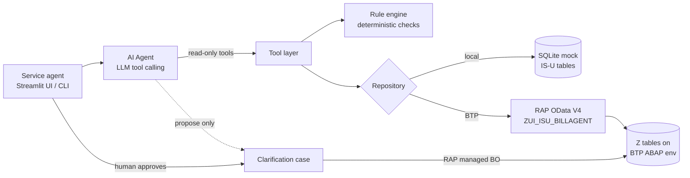

# ⚡ SAP IS-U Bill Anomaly Explainer — AI Agent POC

An AI agent that answers the most common question in utility customer service:
**"Why is this bill so high?"**

It reads SAP IS-U data (contract account, installation, meter reading results, device
history, billing documents, rate prices), runs grounded anomaly checks, and returns:

1. **Verdict** — is the bill correct, and what is the main cause
2. **Evidence** — dates, kWh, prices and document numbers from SAP
3. **What to tell the customer** — plain language, no SAP jargon
4. **Recommended action** — and, when a correction is needed, a *proposed* clarification
   case that a human must approve before anything is written back to SAP

> All data is synthetic. Table and field names are modelled on SAP IS-U
> (BUT000, FKKVKP, EVER, EANL, EGERH, EABL, ERCH, DBERCHZ) but simplified.

---

## Architecture



**Design decisions**

| Decision | Why |
|---|---|
| LLM never calculates; it calls `analyze_bill` | Numbers come from deterministic code → no hallucinated amounts, testable |
| Read-only tools + *propose* case | Human-in-the-loop for any write to SAP (clean, auditable) |
| Same repository interface for SQLite and OData | Develop offline, switch to BTP with one env variable |
| Offline mode with templated answers | Demo works without an API key; also a fallback if the LLM step budget runs out |
| Evaluation set with planted ground truth | Measurable accuracy and false-positive rate, not "it looked right" |

---

## Anomalies detected

| Code | IS-U situation | Key evidence |
|---|---|---|
| `METER_FACTOR` | Device replacement, new register factor maintained wrong | EGERH factor 1 → 10, billed vs expected kWh |
| `LONG_PERIOD` | Scheduled read missed → ~2-month bill | Period days vs usual, unchanged daily usage |
| `ESTIMATE_CATCHUP` | Series of under-estimated reads, then an actual read | ISTABLART 03 streak, under-billed kWh |
| `REVERSAL_REBILL` | Bill reversed and rebilled — customer sees "two bills" | STOKZ = X document + valid rebill |
| `RATE_CHANGE` | Price increase on the rate category | Old/new price, effective date, extra cost |
| `SEASONAL_HEATING` | Winter peak (electric heating) | Daily kWh vs same period last year |
| `USAGE_SPIKE` | Genuine consumption increase, no billing/device cause | % increase, no other events |
| `NORMAL` | Bill in line with history | Ratio vs baseline |

Mock code values: `ISTABLART` 01 utility read, 02 customer read, 03 automatic estimation ·
`ABLESGR` 01 periodic, 21 device installation, 22 device removal.

---

## Results

```
Scenario           Correct  Total
NORMAL                  12     12
ESTIMATE_CATCHUP         4      4
RATE_CHANGE              4      4
METER_FACTOR             4      4
REVERSAL_REBILL          4      4
LONG_PERIOD              4      4
SEASONAL_HEATING         4      4
USAGE_SPIKE              4      4

Overall accuracy: 40/40 = 100%
False positives on normal bills: 0/216
```

The rule engine is evaluated on planted scenarios, so 100% means "detects what it was designed to
detect". Run `eval --llm` to measure the full agent (cause + evidence in the written answer).
Next step for realism: add noisier data (customer self-reads with typos, overlapping causes).

---

## Quick start (local, no API key needed)

```bash
pip install -r requirements.txt
python -m isu_agent.cli generate          # build mock IS-U database (40 accounts, 24 months)
python -m isu_agent.cli accounts          # list demo accounts + planted scenario
python -m isu_agent.cli ask 100000000021 "The latest bill is enormous. What happened?" --show-tools
python -m isu_agent.cli eval              # accuracy + false-positive check
python -m pytest -q                       # unit tests
streamlit run app.py                      # demo UI
```

### Use a real LLM (agent mode)

```bash
export ANTHROPIC_API_KEY=...              # agent switches to LLM tool calling automatically
export ISU_LLM_MODEL=claude-sonnet-5-5    # optional
python -m isu_agent.cli ask 100000000013 "Why is this bill so much higher?" --show-tools
python -m isu_agent.cli eval --llm
```

The model chooses which IS-U data to read (`get_meter_reads`, `get_device_history`, …), must call
`analyze_bill` before concluding, and may call `propose_clarification_case`.
To run through **SAP Generative AI Hub** instead, swap the client in `isu_agent/agent.py`
(`_ask_llm`) for the Gen AI Hub SDK; the tool definitions stay the same.

---

## Deploy the SAP side (BTP ABAP environment trial)

Objects in `abap/` (create in ADT, Eclipse, in your own package e.g. `ZISU_BILLAGENT`):

| Folder | Objects |
|---|---|
| `tables/` | 10 Z tables: `ZISU_BUT000`, `ZISU_FKKVKP`, `ZISU_EVER`, `ZISU_EANL`, `ZISU_EGERH`, `ZISU_EABL`, `ZISU_RATES`, `ZISU_ERCH`, `ZISU_DBERCHZ`, `ZISU_CLARIF` |
| `cds/` | Read views `ZI_ISU_Account`, `ZI_ISU_BillingDocument`, `ZI_ISU_BillingLine`, `ZI_ISU_MeterRead`, `ZI_ISU_DeviceHistory`, `ZI_ISU_RatePrice` + root view `ZI_ISU_ClarificationCase` |
| `behavior/` | Managed RAP BO for clarification cases (UUID numbering, determination sets status OPEN, global authorization) |
| `service/` | Service definition `ZUI_ISU_BILLAGENT` |
| `classes/` | `ZCL_ISU_MOCK_LOADER` — generated loader with 16 accounts / ~2,000 rows (run with F9) |

Steps:
1. Create the tables, activate.
2. Create the CDS views, behavior definition and behavior pool (`zbp_i_isu_clarificationcase`), activate.
3. Create the service definition, then a **service binding** (OData V4 – Web API) and publish it.
4. Create class `ZCL_ISU_MOCK_LOADER` from `classes/`, run it with **F9**.
5. Point the agent at SAP:
   ```bash
   export ISU_DATA_SOURCE=odata
   export ISU_ODATA_URL=<service URL from the binding>
   export ISU_ODATA_USER=... ISU_ODATA_PASSWORD=...
   ```
   On the trial, use a communication user / arrangement or an OAuth token as your trial allows; basic auth
   is shown only for simplicity.

Regenerate the loader for more accounts: `python -m isu_agent.cli export-abap --accounts 40`.

> Written for ABAP Cloud (strict mode 2). Syntax checks can differ by release — fix any activation
> messages in ADT. For production you would add projection views (`ZC_…`) and access controls (DCL).
> The ODataRepository was verified against a simulated service; test it against your binding.

---

## Project structure

```
isu_agent/
  config.py        settings, thresholds, LLM/data-source switches
  mockdata.py      synthetic IS-U data with planted anomalies
  repository.py    SQLite and OData (RAP) data access, same interface
  rules.py         deterministic anomaly checks + evidence
  tools.py         tool specs + read-only tool implementations
  agent.py         LLM tool-calling loop + offline explainer
  evaluate.py      accuracy and false-positive evaluation
  export_abap.py   generates the ABAP data-loader class
  cli.py           command line
app.py             Streamlit demo UI
abap/              SAP objects for the BTP ABAP environment
eval/ground_truth.json   planted scenarios (not visible to the agent)
tests/             pytest
```

---

## 3-minute demo script (for the video)

1. **Problem (20s):** "High-bill complaints are the #1 call driver at utilities. Agents dig through
   EL31, EA22, meter reads and device history for 15–30 minutes per case."
2. **Meter factor case (60s):** account `100000000021` → agent finds the device replacement on
   2026-09-10 with factor 10 instead of 1, ~2,400 kWh billed vs ~330 expected → proposes a case →
   approve it.
3. **Estimation catch-up (40s):** account `100000000013` → three estimated reads, then an actual read.
4. **Reversal (20s):** account `100000000025` → "billed twice" is a reversal + rebill.
5. **Trust (30s):** open the agent trace, show `eval` (40/40, 0/216 false positives) and the
   human-approval step.
6. **SAP side (10s):** RAP service, CDS views and managed BO in ADT.
